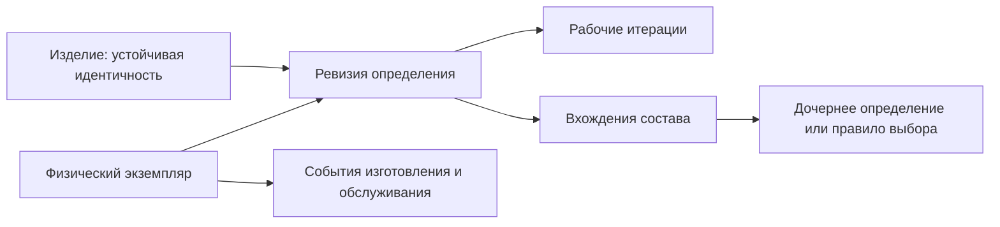

# Предметная область и модель данных

[К навигации темы](README.md)

## Назначение и результат изучения

Предметная модель переводит инженерные понятия в объекты, отношения и ограничения. После темы читатель различает устойчивую идентичность изделия, ревизию определения, рабочую итерацию, позицию состава и физический экземпляр; понимает границы ответственности базы и прикладного сервиса.

## Содержание

### Три уровня идентичности

Обозначение насоса сохраняется при пересмотре определения. Ревизия B представляет новую контролируемую ступень определения. Итерации B.1 и B.2 отражают рабочие сохранения. Это соглашение курса: продукты могут иначе организовывать и называть уровни версионирования. Серийный насос — отдельный физический объект со своей историей изготовления и ремонта.

### Реляционная модель

Концептуально выделяются изделия, ревизии, вхождения, документы, файлы, экземпляры и связи доказательств. Вхождение принадлежит родительской структуре и хранит количество, позиционные признаки и условия включения. Один дочерний объект участвует во многих вхождениях. Первичный ключ обеспечивает техническую идентификацию; обозначение с областью уникальности — бизнес-идентификацию.

### Инварианты и конкуренция

Ссылочная целостность предотвращает ссылки на отсутствующие объекты, но не доказывает допустимость ревизии к выпуску. Предметные ограничения включают отсутствие циклов состава, допустимые состояния и размерность количества. Конкурентное редактирование требует проверки ожидаемой версии и согласованного изменения связанных записей.

[Документация PostgreSQL по изоляции](https://www.postgresql.org/docs/18/transaction-iso.html) различает снимок отдельного запроса и поведение всей транзакции. Выбор изоляции не отменяет обработку конфликтов и возможный повтор транзакции.

## Связи определений и фактов

Стрелки показывают смысловые зависимости, а не готовые внешние ключи. Направление ссылки и кратность выбираются при реализации. В частности, экземпляр может иметь несколько связанных определений разных ролей: исходное изготовление, разрешённая доработка, текущая аппаратно-программная конфигурация.

| Факт | Где его смысловая граница | Что теряется при смешении |
| --- | --- | --- |
| Обозначение | Устойчивая идентичность | История общего изделия между ревизиями |
| Разрешённая геометрия | Контролируемое определение | Возможность воспроизвести старый выпуск |
| Количество в сборке | Вхождение | Различие применений одной детали |
| Установленный серийный компонент | Физическая установка | История конкретного экземпляра |

## Разбор условного примера

Два инженера меняют количество крепежа. Без проверки версии поздняя запись может затереть первую. Оптимистический контроль обнаруживает несовпадение версии, после чего изменения сопоставляются. Блокировка файла не защищает автоматически состав, хранящийся в другой сущности.

## Типичные ошибки

Хранение всех уровней версии одной строкой без правил; изменение выпущенного определения на месте; удаление объекта вместо завершения применимости; одна сущность для планового состава и фактической установки.

---

[Термины и сокращения](../../references/glossary.md)

Подробное рассмотрение: [подтемы раздела](README.md#подтемы).

---

[Предыдущая тема](../01-plm-pdm-foundations/README.md) · [Следующая тема](../03-administration-and-security/README.md) · [Глоссарий](../../references/glossary.md)
