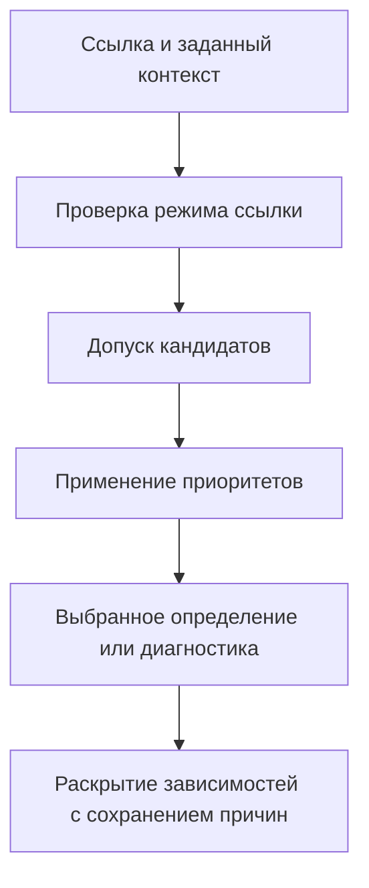

# Конфигурирование по ревизионным правилам

[К навигации темы](README.md)

## Назначение и результат изучения

Ревизионное конфигурирование превращает ссылки на изделия в конкретный набор определений. После темы читатель понимает правила выбора, применяемость, базовые линии и диагностику ситуаций, когда подходящего определения нет или их несколько.

## Содержание

### Контекст выбора

Вход включает корневую ревизию, представление, правило выбора, дату, область серийных номеров или партий и необходимые настройки. Зафиксированная ссылка уже определяет ревизию. Плавающая ссылка требует вычислить её по правилу. Эти режимы нельзя незаметно подменять друг другом.

### Фильтр и порядок

Учебная модель разделяет допуск кандидата и выбор среди допустимых. Состояние и применяемость ограничивают кандидатов, правило приоритета упорядочивает оставшихся. «Последняя выпущенная» требует определения порядка ревизий, допустимых состояний и момента, относительно которого вычисляется результат. Она не означает «последняя строка по времени изменения».

### Применяемость

Дата, серийный диапазон и партия могут ограничивать объекты или вхождения. В модели заранее задают, как сочетаются измерения и включаются границы. Серийный номер сравнивается внутри определённой серии; произвольная строковая сортировка не задаёт инженерный порядок.

### Воспроизводимость

Базовая линия фиксирует согласованный набор управляемых версий и границы его полноты. Сохранение только имени правила не гарантирует воспроизведения: правило и исходные данные могут измениться. Для воспроизводимого результата сохраняют выбранные версии, существенный контекст и происхождение решения.

## Состояния результата разрешения

| Ситуация | Предметный смысл | Поведение учебной модели |
| --- | --- | --- |
| Ровно один итоговый кандидат | Выбор определён | Сохранить выбранную ревизию и причину |
| Кандидатов нет | Нет допустимого определения | Указать ссылку и неисполненные условия |
| Несколько равноприоритетных | Правило не определяет единственный результат | Сообщить неоднозначность |
| Не хватает контекста | Выбор пока не вычислим | Указать необходимый параметр |
| Зависимость скрыта по правам | Видимый результат неполон | Сохранить безопасность и признак неполноты |

Для зафиксированной ссылки выбор уже сделан, но проверка её допустимости в нужной операции может оставаться обязательной. Поэтому «можно воспроизвести» и «можно сейчас использовать для производства» — два разных вопроса.

## Разрешение как вычисление с объяснимым результатом

Удобно представить операцию функцией от структуры, контекста и версии правил. Структура задаёт потенциальные связи, контекст — дату, серию и другие условия, правила — способ выбора. Изменение любого входа способно изменить итог. Поэтому одинаковый корень ещё не означает одинаковую конфигурацию.

### Приоритет не исправляет противоречивые данные

Если две ревизии имеют одинаковую область действия, можно ввести явный приоритет. Но это должно быть осмысленным правилом, а не техническим способом скрыть перекрытие. Политика «брать первую» зависит от порядка чтения и не даёт устойчивого инженерного объяснения.

### Действительность исторического решения

Ранее выбранная конфигурация сохраняет факт своего принятия. Позднее может появиться запрет дальнейшего применения компонента. В этом случае система должна различать воспроизведение прошлого и разрешение нового действия. Исторический отчёт показывает прежний выбор; производственная операция дополнительно учитывает действующие ограничения и управляемые решения.

### Объяснение по каждому пути

Для важного вхождения полезно знать исходную ссылку, рассмотренную область, выбранное определение и причину отклонения остальных кандидатов. Такой результат помогает отличить дефект данных от неверно заданного контекста. При крупном составе объяснение может храниться отдельно от краткой ведомости, но должно оставаться связано с конкретным вычислением и его входами.

## Разбор условного примера

Ревизия A датчика выпущена для серий 1–100, B — начиная с 101. Для серии 100 выбирается A независимо от того, что B новее. Если оба диапазона включают 100, возникает перекрытие. Если ни один не включает 100, возникает разрыв. Молчаливый выбор первой найденной записи скрывает дефект определения.

## Типичные ошибки

Текущая дата вместо даты конфигурации; «самая новая» вместо допустимой; пустой результат вместо диагностированного пропуска; базовая линия, которая фиксирует только корень, но оставляет зависимые файлы плавающими.

---

[Термины и сокращения](../../references/glossary.md)

Подробное рассмотрение: [подтемы раздела](README.md#подтемы).

---

[Предыдущая тема](../08-engineering-bom/README.md) · [Следующая тема](../10-option-configuration/README.md) · [Глоссарий](../../references/glossary.md)
