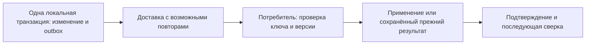

# API, расширения и интеграция предприятия

[К навигации темы](README.md)

## Назначение и результат изучения

Интеграция переносит управляемые факты и решения между системами с разными моделями. После темы читатель понимает сервисный контракт, владение данными, идемпотентность, согласованность обмена и границы прикладных адаптеров.

## Содержание

### Контракт важнее транспорта

API задаёт не только поля запроса, но и смысл операции: полномочия, предусловия, ожидаемую версию, результат и ошибки. Команда «выпустить ревизию» отличается от записи строки состояния. REST или иной способ вызова сам по себе не гарантирует соблюдения предметных правил.

### Граница транзакции

Изменение PLM и изменение ERP обычно не входят в одну локальную транзакцию. Поэтому различают подготовку пакета, отправку, получение, применение и подтверждение. Событие фиксирует совершившийся факт с идентификатором, версией и контекстом. Оно не должно зависеть от последующего чтения уже изменившихся данных без явного правила.

### Повторы и порядок

Идемпотентность означает, что повтор одной логической операции не создаёт нового предметного эффекта. Для неё нужны устойчивый ключ и сохранённый результат. Доставка может дублироваться или менять порядок: потребитель учитывает версии, отложенные зависимости и конфликты. Политика повтора различает временную ошибку и окончательный отказ данных.

### Прикладная логика

Python подходит для автоматизации и анализа, Java — для сервисной логики и адаптеров; это проектное распределение, а не ограничение языков. Предметные инварианты должны иметь определённое место исполнения. Прямая запись во внутренние таблицы коммерческой системы обходит её правила и не рассматривается как общий способ интеграции.

## Граница гарантий обмена

Для логической операции K потребитель различает три ситуации: K ещё неизвестна; K уже выполнена с тем же содержимым; K повторно пришла с другим содержимым. Последняя ситуация — конфликт контракта, а не безопасный повтор. Если обработка включает несколько локальных действий, фиксация эффекта и отметки о выполнении также должна быть согласована.

Outbox закрывает разрыв между локальным изменением и намерением доставить событие. Он не гарантирует сам по себе однократное применение на удалённой стороне. После подтверждённого применения может понадобиться сверка, поскольку бизнес-данные получателя способны измениться независимо.

## Разбор условного примера

PLM отправляет выпущенную MBOM в ERP. Соединение оборвалось после применения пакета, но до подтверждения. Повтор с тем же идентификатором должен вернуть прежний результат либо подтвердить уже выполненное применение, а не создать второй комплект. Следующая ревизия не должна незаметно перезаписать эту историю.

## Типичные ошибки

Ответ сервера как доказательство бизнес-применения; новые ключи при каждом повторе; права интеграции шире её назначения; обратная синхронизация без владельца; обработка события через текущую вместо зафиксированной конфигурации.

---

[Термины и сокращения](../../references/glossary.md)

Подробное рассмотрение: [подтемы раздела](README.md#подтемы).

---

[Предыдущая тема](../16-cad-cam-cae-integration/README.md) · [Следующая тема](../18-migration-and-data-quality/README.md) · [Глоссарий](../../references/glossary.md)
