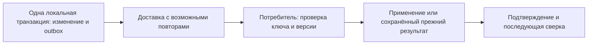

# API, расширения и интеграция предприятия

[К навигации темы](README.md)

## Назначение и результат изучения

Интеграция переносит управляемые факты и решения между системами с разными моделями. После темы читатель понимает сервисный контракт, владение данными, идемпотентность, согласованность обмена и границы прикладных адаптеров.

## Содержание

### Контракт важнее транспорта

API задаёт не только поля запроса, но и смысл операции: полномочия, предусловия, ожидаемую версию, результат и ошибки. Команда «выпустить ревизию» отличается от записи строки состояния. REST или иной способ вызова сам по себе не гарантирует соблюдения предметных правил.

### Граница транзакции

Изменение PLM и изменение ERP обычно не входят в одну локальную транзакцию. Поэтому различают подготовку пакета, отправку, получение, применение и подтверждение. Событие фиксирует совершившийся факт с идентификатором, версией и контекстом. Оно не должно зависеть от последующего чтения уже изменившихся данных без явного правила.

### Повторы и порядок

Идемпотентность означает, что повтор одной логической операции не создаёт нового предметного эффекта. Для неё нужны устойчивый ключ и сохранённый результат. Доставка может дублироваться или менять порядок: потребитель учитывает версии, отложенные зависимости и конфликты. Политика повтора различает временную ошибку и окончательный отказ данных.

### Прикладная логика

Python подходит для автоматизации и анализа, Java — для сервисной логики и адаптеров; это проектное распределение, а не ограничение языков. Предметные инварианты должны иметь определённое место исполнения. Прямая запись во внутренние таблицы коммерческой системы обходит её правила и не рассматривается как общий способ интеграции.

## Граница гарантий обмена

Для логической операции K потребитель различает три ситуации: K ещё неизвестна; K уже выполнена с тем же содержимым; K повторно пришла с другим содержимым. Последняя ситуация — конфликт контракта, а не безопасный повтор. Если обработка включает несколько локальных действий, фиксация эффекта и отметки о выполнении также должна быть согласована.

Outbox закрывает разрыв между локальным изменением и намерением доставить событие. Он не гарантирует сам по себе однократное применение на удалённой стороне. После подтверждённого применения может понадобиться сверка, поскольку бизнес-данные получателя способны измениться независимо.

## Согласованность без общей базы

Когда системы независимы, между локальным изменением и удалённым применением существует промежуток. В нём предприятие должно знать состояние передачи. Отсутствие мгновенной согласованности само по себе не является дефектом, если задержка допустима, прогресс наблюдаем, а результат проверяем. Дефект возникает, когда разные стороны считают завершённым то, что ещё не произошло.

### Команда и событие

Команда выражает просьбу выполнить действие и может быть отклонена. Событие сообщает о совершившемся факте. «Выпустить ревизию» и «ревизия выпущена» поэтому имеют разные контракты. Получатель события может выполнять собственное действие, но его отказ не отменяет исходный факт автоматически.

### Полный пакет и изменение

Передача полного определения упрощает сверку, но увеличивает объём. Передача различий требует знать исходную версию и порядок применения. Если получатель пропустил промежуточное сообщение, следующее изменение может быть неприменимо без восстановления основания. Выбор определяется размером данных, частотой изменений и требуемыми гарантиями.

### Причинный порядок

Событие о связи не может быть предметно применено раньше появления её участников. Потребитель может отложить обработку, запросить недостающие данные или использовать согласованный пакет. Простая временная сортировка не всегда восстанавливает зависимость: часы и доставка различаются. Поэтому идентичность, версия и связь с предыдущим состоянием важнее одного времени отправки.

### Подтверждение и сверка

Подтверждение относится к конкретной операции и результату. Периодическая сверка выявляет расхождения, возникшие после подтверждённой передачи или независимого изменения получателя. Эти механизмы дополняют друг друга и требуют понятного владельца исправления.

## Два вида идентичности в надёжном обмене

Ключ события определяет логическое сообщение; идентификатор агрегата и его версия определяют состояние получателя. Если один и тот же выпуск отправить с новым eventId, проверка только inbox не узнает повтор по ключу. Контракт должен дополнительно определить, допускается ли повтор версии под другим ключом и как он диагностируется. L13 сознательно отклоняет новое событие, если версия не равна current+1.

При точном повторе сначала ищут сохранённую квитанцию, затем оценивают продвижение агрегата. Иначе повтор уже применённого события после более новых версий ошибочно станет обычным stale-отказом. Конфликт того же ключа с другим содержимым сохраняет смысл ошибки даже при совпадении текущего состояния получателя.

### Снимок, каноническая форма и хеш

Передаваемый снимок должен содержать данные, необходимые для заявленного эффекта, либо ссылку на гарантированно неизменяемый пакет. Имя BASE-01 без версии содержимого не даёт такой гарантии. Если сравниваются хеши JSON, сначала определяют каноническую форму: порядок полей, представление чисел, единицы и допустимые отсутствующие значения. Различные байты могут иметь один смысл, а одинаковое имя пакета — разный смысл.

L13 сравнивает точную строку payload и не сериализует настоящую MBOM. Это достаточный контракт для демонстрации атомарности, но не готовый промышленный обмен. Его общая блокировка таблиц сериализует независимые агрегаты. Замена её блокировкой существующей строки требует отдельно решить первый INSERT, конфликт общего eventId и порядок захвата блокировок.

[WRS 2.7](../../references/vendor-mechanisms.md#wc-api) показывает, что версия бизнес-системы и версия доменного API различаются. Наличие REST/OData не обеспечивает автоматически идемпотентность бизнес-команды, порядок событий или согласованное применение пакета. Эти свойства должны быть установлены контрактом адаптера.

## Разбор условного примера

PLM отправляет выпущенную MBOM в ERP. Соединение оборвалось после применения пакета, но до подтверждения. Повтор с тем же идентификатором должен вернуть прежний результат либо подтвердить уже выполненное применение, а не создать второй комплект. Следующая ревизия не должна незаметно перезаписать эту историю.

## Типичные ошибки

Ответ сервера как доказательство бизнес-применения; новые ключи при каждом повторе; права интеграции шире её назначения; обратная синхронизация без владельца; обработка события через текущую вместо зафиксированной конфигурации.

---

[Термины и сокращения](../../references/glossary.md)

Подробное рассмотрение: [подтемы раздела](README.md#подтемы).

---

[Предыдущая тема](../16-cad-cam-cae-integration/README.md) · [Следующая тема](../18-migration-and-data-quality/README.md) · [Глоссарий](../../references/glossary.md)

## Практическое закрепление

[L13. Java-потребитель: повтор, конфликт и откат](../../practice/exercises/l13-integration/README.md). Условия, границы, заготовки и переход к эталону приведены в задании.
